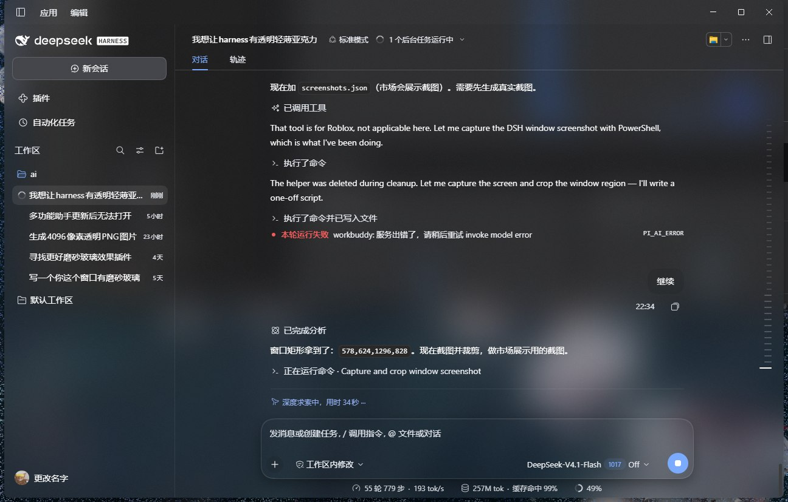
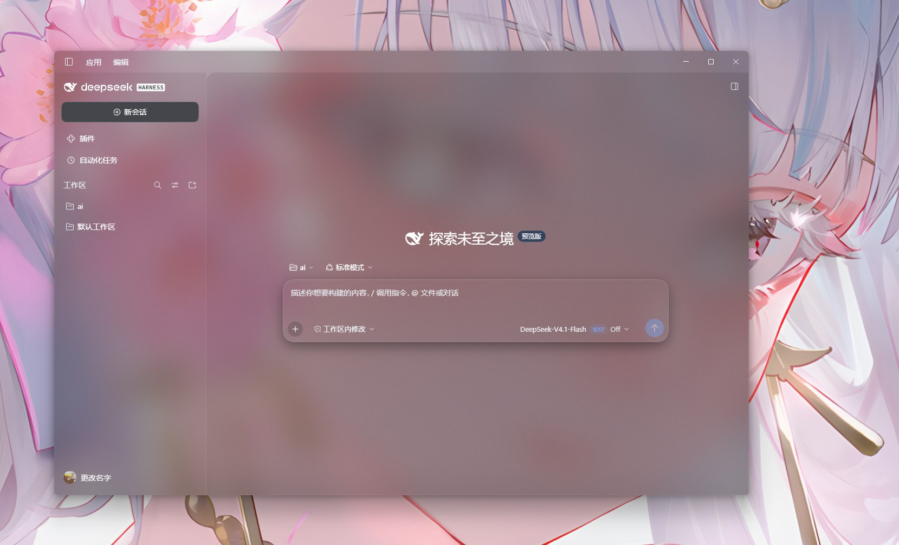

# dsh-acrylic

> **本项目的代码与文档均由 AI 编写。**  
> 从需求讨论、逆向 DSH 窗口参数、调试、到这份 README，全部由 AI Agent 与用户协作完成。
> 详见文末「关于本项目」。

> DeepSeek Harness 桌面版的**透明轻薄亚克力**主题。  
> 窗口透出桌面壁纸，由 Windows 系统 Acrylic 材质负责模糊；页面分层雾面，输入栏与浮层保持可读。

[效果](#效果) · [安装](#安装) · [调参](#调参) · [卸载](#卸载) · [已知限制](#已知限制)

---

## 效果

同一套主题，换不同壁纸的效果 —— 壁纸的颜色和明暗会透上来，界面跟着变，但文字始终清晰：

| 秋叶 | 森林 |
| --- | --- |
|  |  |

| 雨天 | 樱花 |
| --- | --- |
|  |  |

| 区域 | 表现 |
| --- | --- |
| 主面板 / 顶栏 | 完全透明，透出壁纸，模糊由系统 Acrylic 完成 |
| 侧栏 / 三列 | 极淡底色（8%–10%），保留层次 |
| 输入栏 | `rgb(16 18 22 / 92%)` 实色雾面，与背景明确分层 |
| 悬停预览 / 菜单 / 工具提示 | `rgb(20 22 28 / 18%)` + `blur(12px)` |
| 设置面板 / 对话框 | `rgb(26 28 34 / 78%)` + `blur(24px)` |
| 代码块 | `rgb(20 22 28 / 55%)`，保证长段可读 |

> 深色主题下文字会自动提亮：`label-primary/secondary/tertiary` 及底层
> `bluish-200/300/400/600/700` 一并改为白色系，否则深底上发灰。

---

## 先分清两个「插件」入口

DSH 里有两个容易混淆的地方，安装方式完全不同：

| 入口 | 是什么 | 本插件怎么装 |
| --- | --- | --- |
| **设置 → 「插件」页 → 添加插件** | DSH **内置**的插件管理页，用 `dsh plugin add` 安装任意来源 | ✅ **推荐**，粘贴仓库地址即可 |
| **插件市场**（dsh-market） | 一个**第三方社区插件**，它有自己的插件目录与详情页 | ⏳ 需先被该目录收录（见下文） |

两者的关系是：插件市场本身也是装在「插件」页里的一个插件。它展示什么，取决于它自己的目录文件，与内置的「添加插件」无关。

**所以：现在就能装，用第一种方式。** 想让它出现在插件市场里被搜到，需要走第三种方式（提交收录）。

---

## 安装

### 第 1 步：在「插件」页添加（现在就能用）

1. 打开 Harness → **设置**
2. 进入 **插件**（内置的那一页，不是插件市场）
3. 点 **「添加插件」**
4. 在弹出的输入框里填下面任意一种：

   ```
   https://github.com/YSDLNGF/dsh-acrylic
   ```

   也接受这几种等价写法：

   ```
   https://github.com/YSDLNGF/dsh-acrylic.git
   github:YSDLNGF/dsh-acrylic
   ```

   > 输入框提示是「输入插件的包名、GitHub 仓库地址或本地目录路径」。
   > 本插件尚未发布到 npm，所以请用 **GitHub 地址**，不要填包名。

5. 点「安装」，确认来源，Harness 会自己 clone 到
   `~/.dsh/profiles/desktop/node_modules/dsh-acrylic`、登记 `bundles`，然后提示重启

重启后进入 **设置 → 通用 → 透明亚克力**，看到滑块就说明页面那半边成功了。

> **安装格式依据**：`@deepseek-ai/dsh-plugin-manager` 的 `parseInstallSpec()`
> 接受 npm 包名、`file:`/绝对路径、`*.tgz`、以及 git 地址
> （`github:owner/repo`、`git+https://…`、或宿主仓库 URL）。
> 本仓库根 `package.json` 已声明 `dsh.bundle`，满足「可安装」的判定条件。

### 第 2 步：让窗口透出壁纸（这一步需要命令行）

第 1 步只让页面半透明，但窗口本身还是不透明的 —— 壁纸透不出来。
窗口材质是 Electron `BrowserWindow` 的**构造参数**，只存在于主进程，
插件（运行在渲染进程侧）碰不到窗口对象，所以必须改 `app.asar`。

这与现有同类插件（如 [dsh-desktop-glass](https://github.com/JianHeShui/dsh-desktop-glass)）
的处境相同，**没有纯插件方案**。

```powershell
cd dsh-acrylic
powershell -ExecutionPolicy Bypass -File .\apply-when-closed.ps1
```

这个脚本会：

1. 等你从托盘退出 Harness（它监测 `app.asar` 锁释放）
2. 自动给 `app.asar` 打**等字节补丁**（主窗口加 `backgroundMaterial: acrylic`）
3. 自动重启 Harness

**你只需要退出一次，剩下它自己完成。**

做完这步，窗口才能真正透出壁纸。

### 第 3 步：让它出现在插件市场（可选）

插件市场（dsh-market）的插件列表来自一份目录文件，托管在社区仓库
[awesome-dsh-plugin](https://github.com/awesome-dsh-plugin/awesome-dsh-plugin)。
**要被市场搜到，必须向那个仓库提交一个条目文件。** 这不是自动的。

收录要求与当前状态：

| 要求 | 状态 |
| --- | --- |
| 根 `package.json` 声明 `dsh.bundle` | ✅ `./plugin/cordis.patch.yml` |
| 仓库有真实可用代码 | ✅ |
| `screenshots.json` + 截图 | ✅ `assets/screenshot-1.jpg` |
| 仓库 topic `dsh-plugin` | ✅ 已添加 |
| 仓库创建满 1 天 | 由对方 CI 检查 |
| 条目文件 | ⏳ 待提交 PR |

需要提交的文件（单个 YAML，放在对方仓库 `data/plugins/` 下）：

**`data/plugins/YSDLNGF__dsh-acrylic.yml`**

```yaml
url: https://github.com/YSDLNGF/dsh-acrylic
name: YSDLNGF/dsh-acrylic
category: theme
description:
  en: Windows Acrylic window material plus layered frosted panels for the DeepSeek Harness desktop app.
  zh: DeepSeek Harness 桌面版的 Windows 亚克力窗口材质与分层雾面效果。
```

分类选 `theme` 的话，合并后会进入插件市场的**「主题」Tab**，
支持一键安装、切换、卸载。

合并后官网自动重建，市场里就能搜到了。

---

## 卸载

**只卸载插件（保留窗口补丁）**：设置 → **插件**（内置那页），
找到 `dsh-acrylic`，点「卸载」。

**连同窗口材质一起还原**：

```powershell
node uninstall.mjs
powershell -ExecutionPolicy Bypass -File .\restore-asar.ps1
```

两者都做完再重启，恢复原生外观。

---

## 调参

两种方式，均**实时生效，无需重启**：

**控制台**（F12 → Console）：

```js
glass()                      // 看当前参数
glass({ alpha: 92 })         // 浮层/输入栏厚度，越大越实
glass({ noise: 4 })          // 亚克力颗粒感
glass({ enabled: false })    // 一键关闭
glass.reset()                // 回默认
```

**设置页**：`设置 → 通用 → 透明亚克力`，带滑块。

| 参数 | 默认 | 说明 |
| --- | --- | --- |
| `alpha` | 92 | 浮层与输入栏的雾面厚度。92 是实测最平衡的一档 |
| `noise` | 3.2 | 亚克力细微噪点，纯色平板没有"薄"感 |

改色值请直接编辑 `plugin/client.js` 顶部的 `GLASS_STYLE`，每个值旁都注明了由来。

---

## 已知限制

- **窗口材质补丁在 Harness 更新后失效**。更新会覆盖 `app.asar`，
  重跑一次 `apply-when-closed.ps1` 即可。
- **插件市场至今搜不到**：本插件尚未被
  [awesome-dsh-plugin](https://github.com/awesome-dsh-plugin/awesome-dsh-plugin)
  目录收录，因此第三方市场「插件市场」（dsh-market）里搜不到。
  收录需要向该仓库提交 PR（见「第 3 步」）。
  **这不影响安装** —— 用内置「插件」页的「添加插件」粘 GitHub 地址即可。
- **改的是宿主程序**。请自行评估风险；本仓库提供备份与还原路径，
  且补丁脚本在锚点不匹配时会直接退出、不动已安装文件。
- **Acrylic 失焦会变实**。Windows 降级材质行为，无法绕过。
  介意可改用 `-Material mica`。

---

## 需要自己编译安装吗

不需要。本仓库是**即插即用**的 DSH 插件，不是需要 build 的前端项目：

| 文件 | 作用 | 需要编译吗 |
| --- | --- | --- |
| `package.json` | 根 manifest（声明 `dsh.bundle`，供市场/命令行安装） | ❌ |
| `plugin/` | 插件本体（页面半边） | ❌ 直接复制 |
| `patch-asar.mjs` | 改 `app.asar` 的工具 | ❌ Node 直接跑 |
| `apply-when-closed.ps1` | 自动化：等退出→打补丁→重启 | ❌ |
| `install.mjs` / `uninstall.mjs` | 命令行方式装卸 | ❌ |

用 Node 18+ 和 PowerShell 即可，**没有构建步骤**。

---

## 关于本项目

**本项目的代码与文档全部由 AI 编写。**

从用户一句"我想让 harness 有透明轻薄亚克力效果"开始，
确认需求、逆向 `main.js` 里的窗口参数、发现 `backgroundColor` 与
`backgroundMaterial` 互斥、逐层定位"发灰"来源、把侧栏收起按钮位移的
bug 定位到 `backdrop-filter` 创建包含块、到最终的分层雾面方案 ——
包括 `plugin/client.js` 里的每一条规则、每一个数值、这几百行中文注释，
以及这份 README，都出自 AI Agent 之手（与用户多轮协作完成）。

**也走了不少弯路。** 曾经连续多轮在错误假设上打转，以为调
`backdrop-filter` 的 blur 值就能糊掉背后的文字，直到做像素测量才发现
它从未生效；也曾把"插件市场"和内置的"添加插件"混为一谈，
写出了错误的安装说明。这些失败结论都被写进了代码注释和「已知限制」，
因为**知道什么行不通，和知道什么行得通同样有用**。

如果你也在做类似的事，希望这个仓库能替你省掉那些来回试错的夜晚。

欢迎提交 Issue 或 PR。

## License

[MIT](./LICENSE)
