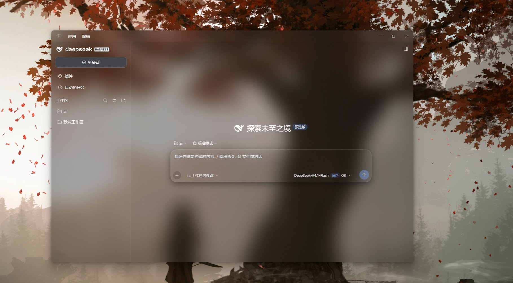
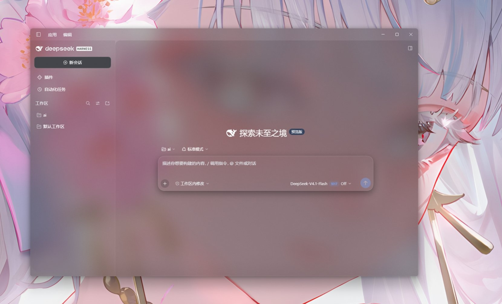
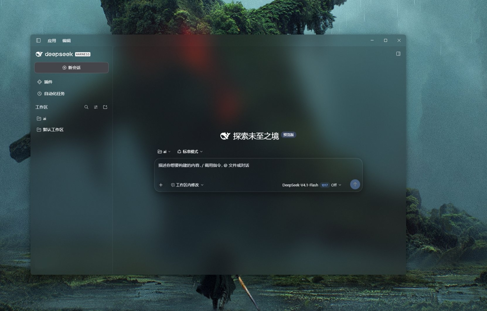

# dsh-acrylic-light

> **本项目的代码与文档均由 AI 编写。**  
> 从需求讨论、逆向 DSH 窗口参数、调试、到这份 README，全部由 AI Agent 与用户协作完成。
> 详见文末「关于本项目」。

> DeepSeek Harness 桌面版的**透明轻薄亚克力**主题。  
> 窗口透出桌面壁纸，由 Windows 系统 Acrylic 材质负责模糊；页面分层雾面，输入栏与浮层保持可读。

[效果](#效果) · [安装](#安装) · [插件市场](#插件市场上架) · [卸载](#卸载) · [已知限制](#已知限制)

---

## 效果

同一套主题，换不同壁纸的效果 —— 壁纸的颜色和明暗会透上来，界面跟着变，但文字始终清晰：

| 示例 1 | 示例 2 |
| --- | --- |
|  |  |

| 示例 3 |
| --- |
|  |

| 区域 | 表现 |
| --- | --- |
| 主面板 / 顶栏 | 完全透明，透出壁纸，模糊由系统 Acrylic 完成 |
| 侧栏 / 三列 | 极淡底色（8%–10%），保留层次 |
| 输入栏 | 透明雾面玻璃，文字在输入栏上沿**硬断**（不钻进输入栏背后） |
| 悬停预览 / 菜单 / 工具提示 | `rgb(20 22 28 / 18%)` + `blur(12px)` |
| 设置面板 / 对话框 | `rgb(26 28 34 / 78%)` + `blur(24px)` |
| 代码块 | `rgb(20 22 28 / 55%)`，保证长段可读 |

> 深色主题下文字会自动提亮：`label-primary/secondary/tertiary` 及底层
> `bluish-200/300/400/600/700` 一并改为白色系，否则深底上发灰。

## 为什么窗口能透出壁纸

窗口材质（`backgroundMaterial`）是 Electron `BrowserWindow` 的**构造参数**，
只存在于主进程。插件跑在独立的 Node 进程里，`require('electron')` 直接报
`Cannot find module 'electron'`，拿不到窗口对象 —— 所以**没有纯插件方案**，
必须给 `app.asar` 打一次补丁（同类插件也一样）。本插件把「打补丁」做成了
**一键脚本**，双击一次即可完成：退出→等字节补丁→校验→自动重启。

---

## 安装

本插件**已在插件市场（dsh-market）上架**，也支持从 GitHub 直接安装。二选一即可。

### 方式一：从插件市场安装（推荐，最简单）

1. 打开 Harness → **设置 → 插件**，进入**插件市场**
2. 切到**「主题」**分类，搜 **`dsh-acrylic-light`**（或「透明亚克力」）
3. 点击**安装**，确认来源，重启提示后重启

安装完成后进入 **设置 → 通用 → 透明亚克力**，把「启用」打开。

> 插件市场安装**只装页面一半**。窗口要透出壁纸还需要补丁 —— 见下方「第 2 步补丁」。

### 方式二：从 GitHub 地址安装

1. 打开 Harness → **设置 → 插件**（内置那一页，不是插件市场）
2. 点 **「添加插件」**，输入：

   ```
   https://github.com/YSDLNGF/dsh-acrylic-light
   ```

   也接受这几种等价写法：

   ```
   https://github.com/YSDLNGF/dsh-acrylic-light.git
   github:YSDLNGF/dsh-acrylic-light
   ```

   > Harness 会 clone 到 `~/.dsh/profiles/desktop/node_modules/dsh-acrylic-light`、
   > 登记 `bundles`，然后提示重启。

### 第 2 步（两种方式都需做）：让窗口透出壁纸 —— 双击一次即可

只装插件只改了页面样式，窗口本身仍是不透明的。这一步让壁纸透出来：

**下载补丁包 zip 解压，然后双击其中的 `enable-transparency.cmd`。**  
补丁包直接把整套脚本打包好了，无需整仓下载：[`releases/dsh-acrylic-light-patch.zip`](releases/dsh-acrylic-light-patch.zip)。

> 或者 clone 本仓库后，直接在仓库根目录双击 `enable-transparency.cmd`（内容相同）。

它会：

1. 等你自己从托盘退出 Harness（它会一直等，直到进程消失）
2. 自动给 `app.asar` 打**等字节补丁**（主窗口加 `backgroundMaterial: acrylic`，
   标题栏 overlay 改透明）
3. 校验补丁确实写进归档
4. 自动重启 Harness

**你只需要退出一次，剩下它自己完成。**

> 命令行等价：
> ```
> powershell -ExecutionPolicy Bypass -File .\apply-when-closed.ps1
> ```
>
> 补丁只在改动 `main.js` 的几处属性，**文件总大小不变**（等字节修补），
> 所以不会破坏 asar 的其他条目。锚点对不上时脚本直接失败退出，不动已安装文件。

---

## 插件市场上架

本插件已被 [awesome-dsh-plugin](https://github.com/awesome-dsh-plugin/awesome-dsh-plugin)
仓库收录，市场目录见
[`data/plugins/YSDLNGF__dsh-acrylic-light.yml`](https://raw.githubusercontent.com/awesome-dsh-plugin/awesome-dsh-plugin/main/data/plugins/YSDLNGF__dsh-acrylic-light.yml)，
分类为 `theme`，会出现在插件市场的**「主题」Tab**，支持一键安装、切换、卸载。

> 仓库自带的 `contrib/YSDLNGF__dsh-acrylic-light.yml` 是提交给市场的源文件，
> 与市场上线版保持一致。

---

## 卸载

**只卸载插件（保留窗口补丁）**：设置 → **插件**（内置那页），
找到 `dsh-acrylic-light`，点「卸载」。

**连同窗口材质一起还原**：

```powershell
node uninstall.mjs
powershell -ExecutionPolicy Bypass -File .\restore-asar.ps1
```

两者都做完再重启，恢复原生外观。

> 卸载时若提示文件被占用（DSH 正在运行），重启后运行
> `cleanup-uninstall.ps1` 清理残留即可。

---

## 设置与实时调参

**设置页**：`设置 → 通用 → 透明亚克力`，只保留**「启用」**开关。关闭即恢复原生外观。

**控制台实时调参**（F12 → Console，无需重启）：

```js
glass()                    // 看当前参数
glass({ enabled: false })  // 一键关闭
glass.reset()              // 回默认
```

> 往版有 `alpha` / `noise` 滑块，已在视觉方案稳定后移除。想改配色直接编辑
> `plugin/client.js` 顶部的 `GLASS_STYLE`，每个值旁都注明了由来。

---

## 这个仓库里都有什么

`plugin/` 是插件本体，其余是透明的补丁工具与安装脚本。**没有构建步骤**，即插即用：

| 文件 | 作用 | 需要编译吗 |
| --- | --- | --- |
| `plugin/client.js` | 插件本体（页面样式 + 输入栏硬裁） | ❌ |
| `plugin/index.js` | 插件宿主半部（提供桌面壁纸路由） | ❌ |
| `patch-asar.mjs` | 给 `app.asar` 打窗口材质补丁的工具 | ❌ Node 直接跑 |
| `enable-transparency.cmd` | 一键：等退出→打补丁→校验→重启 | ❌ 双击即可 |
| `apply-when-closed.ps1` | 上面的脚本主体 | ❌ |
| `restore-asar.ps1` | 还原补丁 | ❌ |
| `verify-asar.mjs` | 校验补丁是否写进归档 | ❌ |
| `install.mjs` / `uninstall.mjs` | 命令行安装 / 卸载插件 | ❌ |
| `卸载.cmd` | 双击卸载入口 | ❌ |

用 Node 18+ 或 PowerShell 即可。**没有构建步骤。**

---

## 已知限制

- **插件无法自己打开窗口材质**（实测结论）。窗口材质是 `BrowserWindow`
  的**构造参数**，而插件宿主跑在独立 Node 进程里 —— `require('electron')`
  直接报 `Cannot find module 'electron'`，拿不到窗口对象。
  Electron 30+ 的 `win.setBackgroundMaterial()` 运行时 API 同样需要窗口对象，
  这条路也不通。所以「透出桌面壁纸」只能靠补丁改 `app.asar`。
- **窗口材质补丁在 Harness 更新后失效**。更新会覆盖 `app.asar`，
  重跑一次 `apply-when-closed.ps1`（或 `node patch-asar.mjs --asar <路径>`）即可。
- **改的是宿主程序**。请自行评估风险；本仓库提供备份与还原路径，
  且补丁脚本在锚点不匹配时会直接退出、不动已安装文件。
- **Acrylic 失焦会变实**。Windows 降级材质行为，无法绕过。
  介意可改用 `-Material mica`。
- **输入栏硬裁依赖移动 React 节点**。聊天内容滚到输入栏上沿会被硬切，
  这是输入栏透明的必然代价；冷启动已做防抖动保护，正常情况下重启不空白。

---

## 关于本项目

**本项目的代码与文档全部由 AI 编写。**

从用户一句"我想让 harness 有透明轻薄亚克力效果"开始，
确认需求、逆向 `main.js` 里的窗口参数、发现 `backgroundColor` 与
`backgroundMaterial` 互斥、逐层定位"发灰"来源、把侧栏收起按钮位移的
bug 定位到 `backdrop-filter` 创建包含块、到最终的分层雾面方案 ——
包括 `plugin/client.js` 里的每一条规则、每一个数值、这几百行中文注释，
以及这份 README，都出自 AI Agent 之手（与用户多轮协作完成）。

**也走了不少弯路。** 曾经连续多轮在错误假设上打转，以为调
`backdrop-filter` 的 blur 值就能糊掉背后的文字，直到做像素测量才发现
它从未生效；也曾把"插件市场"和内置的"添加插件"混为一谈，
写出了错误的安装说明；还曾用「纯 CSS 蒙版」和「绝对定位」两种方式裁输入栏，
要么切线随文本滚动、要么输入栏不再压缩滚动容器而裁切失效，
直到改用「把输入栏座作为 flex 兄弟」才真正实现固定位置硬裁。
这些失败结论都被写进了代码注释和「已知限制」，
因为**知道什么行不通，和知道什么行得通同样有用**。

如果你也在做类似的事，希望这个仓库能替你省掉那些来回试错的夜晚。

欢迎提交 Issue 或 PR。

## License

[MIT](./LICENSE)